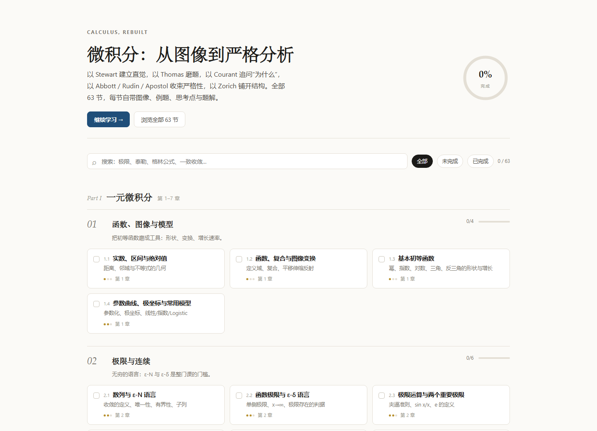
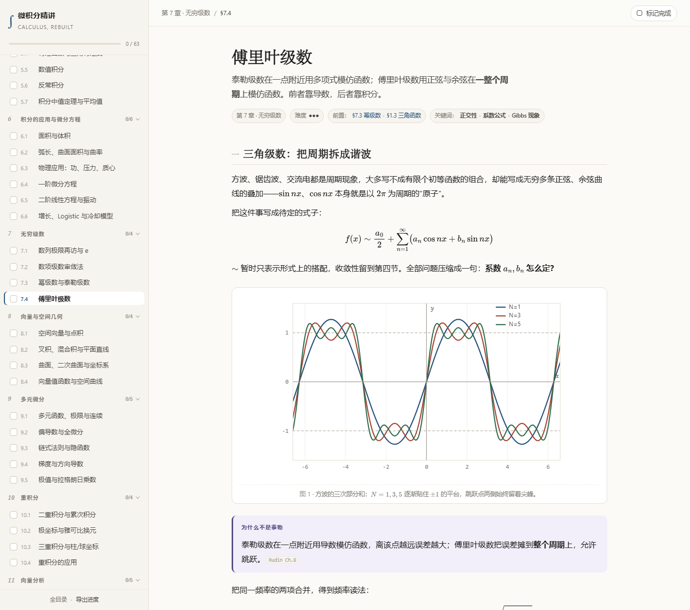

# 微积分精讲 · Calculus, rebuilt

一套**少文字、多数学语言、多图像**的微积分课程。63 节，按「一元微积分 → 多元与向量分析 → 严格分析」三部分组织，每节独立成 HTML 页面，目录页与侧边栏都可以勾选学习进度。

全站合计：**305 幅图**（其中 169 幅由浏览器按函数表达式实时绘制）、**313 个例题**、**449 道习题**（每题先思路后答案）、**135 个思考点**、约 **8.7 万字**正文（不含公式与表格）。





## 打开方式

直接双击 `index.html`（Chrome / Edge / Firefox 均可）。全部资源本地化：MathJax 在 `assets/mathjax/`，无需联网。

若浏览器禁用了 `file://` 的本地存储，勾选不会跨页保存。此时用一行命令起本地服务：

```powershell
cd D:\Project\math
python -m http.server 8000
# 浏览器打开 http://localhost:8000/
```

## 进度

- 目录页每张卡片、每节页面的侧边栏都有复选框。打勾 = 完成本节，卡片与侧栏出现 ⭐。
- 进度存在浏览器 `localStorage`（键 `calculus.progress.v1`），不上传。
- 目录页底部可 **导出 / 导入 / 重置** 进度（JSON 文件），换浏览器或换机器时迁移用。
- 页面右上角「标记完成」与侧边栏勾选等价；`←` / `→` 键切换上一节、下一节。

## 结构

```
index.html                  目录（63 节，按部分 → 章 → 节聚合）
sections/X-Y.html           每一节
assets/style.css            版式
assets/app.js               侧边栏、进度、自动绘图
assets/toc.js               课程结构（由 curriculum.py 生成，勿手改）
assets/mathjax/             本地 MathJax
tools/site/curriculum.py    课程结构数据源
tools/site/build.py         重建 index.html 与 assets/toc.js
tools/site/check.py         单节内容自检（图/例题/习题/公式/链接）
AUTHORING.md                写作规范（组件、绘图 API、硬约束）
```

## 三部分与读法

| 部分 | 章 | 适合 |
|---|---|---|
| I 一元微积分 | 1–7 | 大一上、考研基础、工科主干 |
| II 多元与向量分析 | 8–11 | 大一下、场论与电磁/流体前置 |
| III 严格分析 | 12 | 数学系分析入门、想读懂证明的人 |

三条推荐路线：

- **工科快线**（约 45 节）：1.1–1.4、2.1–2.5、3.1–3.7、4.1–4.3、5.1–5.3、5.6、6.1–6.4、7.1–7.3、8–11 全学；跳过所有 `.deep`。
- **完整主线**（63 节）：按目录顺序，每节的 `.deep` 折叠块至少读一遍。
- **分析路线**：先读 12.1–12.3，再回头重读 2.2、2.6、3.6、5.2、7.2，最后读 12.4–12.5。

## 参考书分工

| 用途 | 书 |
|---|---|
| 新知识、直觉与图像 | James Stewart, *Calculus: Early Transcendentals* |
| 习题与题解风格 | George B. Thomas, *Thomas' Calculus* |
| 「为什么」与动机 | Richard Courant & Fritz John, *Introduction to Calculus and Analysis* |
| 定理证明（基础 / 进阶 / 补充） | Stephen Abbott *Understanding Analysis*；Walter Rudin *Principles of Mathematical Analysis*；Tom M. Apostol *Mathematical Analysis* |
| 结构、例子与推广 | Vladimir A. Zorich, *Mathematical Analysis I / II* |

节内出处标注（如 `Stewart Ch.3`、`Rudin 3`）只指到章，避免伪造小节号。

## 新增一节

1. 在 `tools/site/curriculum.py` 的对应章里加一行 `("X.Y", "标题", "一句话核心", 难度)`。
2. `python tools/site/build.py` 重建目录与侧栏数据。
3. 按 `AUTHORING.md` 写 `sections/X-Y.html`，用 `python tools/site/check.py sections/X-Y.html` 自检。

## 图形系统

`figure.plot` 由 `assets/app.js` 在浏览器里画成 SVG，支持函数曲线、着色区域、切线/割线、黎曼矩形、ε-δ 带、数轴、方向场。写法见 `AUTHORING.md` 第 4 节。几何体、参数曲线、极坐标曲线用手写 inline SVG（`class="dgm"`）。
